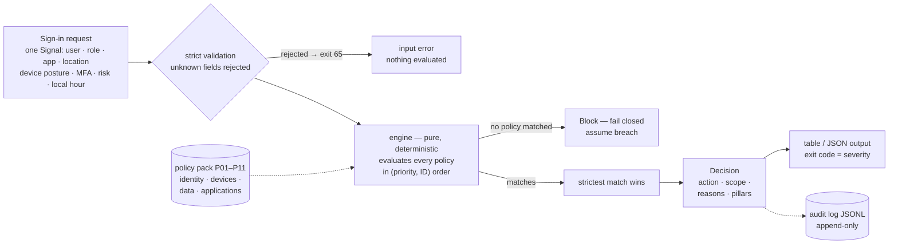
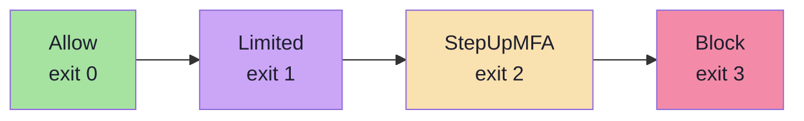
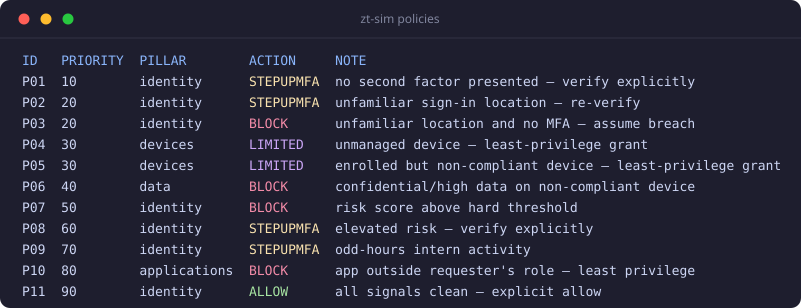
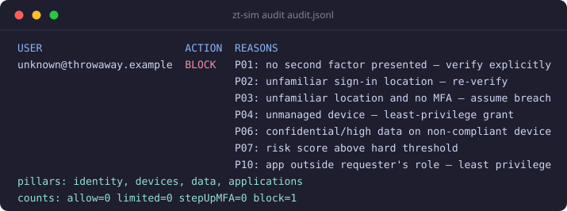
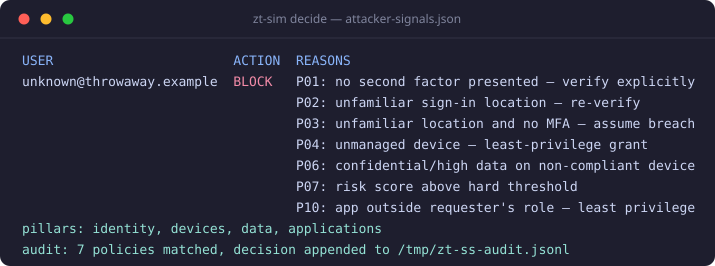
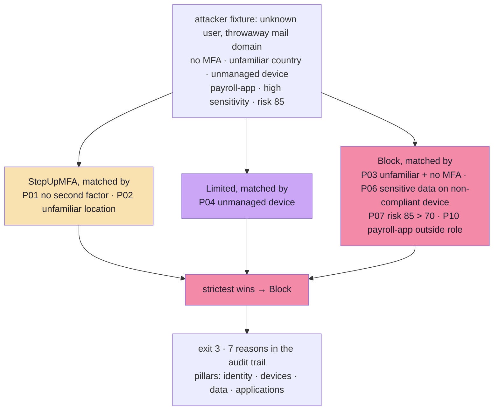
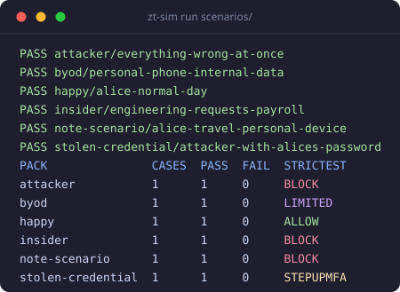

# zt-sim — Zero Trust access simulator

A small, dependency-free Go CLI that acts as a **Zero Trust policy decision engine**: it
reads sign-in requests with their signals (identity, device, location, data sensitivity,
risk), evaluates them against an ordered set of conditional-access policies, and outputs
a decision — **Allow / StepUpMFA / Limited / Block** — with a full audit trail explaining
*why*. Built as a hands-on companion to SC-900 (Microsoft *Security, Compliance, and
Identity Fundamentals*) study notes: **verify explicitly** becomes multi-signal
evaluation, **least privilege** becomes narrowed `Limited` grants and role checks, and
**assume breach** becomes fail-closed defaults plus an append-only audit log. The engine
is pure — no I/O, no clock, no randomness — so every decision is deterministic and
table-testable.

## How it works

Every invocation walks the same path — signals in, one decision out, everything on the
record:



The four actions form a strictness ladder — when several policies match, the one that
leaves the *most verification* between the requester and the resource wins. A
`Limited` grant hands out access now (merely narrowed); `StepUpMFA` withholds access
until a second factor is presented:



Most permissive on the left, strictest on the right — which is also why the stolen-credential
scenario ends in an MFA challenge rather than a read-only grant: an attacker holding only a
password still has a verification layer to beat.

## Install

Requires Go 1.27. Zero external dependencies — `go build` works offline.

```sh
git clone <this-repo> && cd zero-trust-access-simulator
go build -o zt-sim .        # or: make build
go test ./...               # the scenario packs double as acceptance tests
```

## Usage

```
usage: zt-sim decide [--stdin] [--format table|json] [--audit <file>] <signals.json>
usage: zt-sim run [--audit <file>] <scenarios-dir>
usage: zt-sim policies
usage: zt-sim audit <audit.jsonl>
```

- `decide` evaluates a JSON array of signals (`--stdin` reads exactly one signal object
  from stdin, strict decoding either way — misspelled keys are rejected, not zero-valued)
- `run` walks a directory of scenario packs, checks each `expect` block, and prints a
  per-pack summary
- `policies` lists the loaded policy pack
- `audit` re-prints and validates an audit log (counts by action)
- `--audit <file>` (decide/run) appends one JSON record per decision to an append-only
  JSONL log — existing lines are never rewritten
- `--format json` (decide only) emits a machine-readable `[]Decision`
- Global: `--version`

The four outcomes, and how strict they are (strictest match wins):

| Action | Meaning | Exit code |
|---|---|---|
| Allow | all signals clean, low risk | 0 |
| Limited | identity checks out, but device posture / least privilege caps the grant (read-only, time-boxed JIT) | 1 |
| StepUpMFA | some doubt (no second factor yet, unfamiliar location, medium risk) → require MFA before any grant | 2 |
| Block | high risk or hard fail conditions | 3 |



*The policy pack as the CLI lists it — the same 11 rows as the table below.*



*The audit subcommand re-prints a log and counts decisions by action.*

## Exit codes

| Command | Codes |
|---|---|
| `decide` | 0 Allow, 1 Limited, 2 StepUpMFA, 3 Block (strictest decision across all inputs), 64 usage, 65 bad input |
| `run` | 0 all expectations pass, 1 ≥1 expectation failed, 64 usage, 65 bad pack |
| `policies`, `audit` | 0 ok, 64 usage, 65 unreadable/corrupt log |

## Policies

The v1 pack lives in code (`internal/policies`) — typed Go matchers beat hand-rolled
config parsing at this size. Policies are evaluated in `(Priority, ID)` order, **all** of
them (no short-circuit); the final action is the strictest match. Zero matches → Block
(fail closed — the engine never defaults to a grant).

| ID | Priority | Pillar | When | Then | Note |
| --- | --- | --- | --- | --- | --- |
| P01 | 10 | identity | `!MFAPresent` | StepUpMFA | no second factor presented — verify explicitly |
| P02 | 20 | identity | `UnfamiliarLoc` | StepUpMFA | unfamiliar sign-in location — re-verify |
| P03 | 20 | identity | `UnfamiliarLoc && !MFAPresent` | Block | unfamiliar location and no MFA — assume breach |
| P04 | 30 | devices | `!DeviceManaged` | Limited (read-only) | unmanaged device — least-privilege grant |
| P05 | 30 | devices | `DeviceManaged && !DeviceCompliant` | Limited (read-only) | enrolled but non-compliant device — least-privilege grant |
| P06 | 40 | data | `SensitivityRank >= confidential && !DeviceCompliant` | Block | confidential/high data on non-compliant device |
| P07 | 50 | identity | `RiskScore > 70` | Block | risk score above hard threshold |
| P08 | 60 | identity | `40 <= RiskScore <= 70` | StepUpMFA | elevated risk — verify explicitly |
| P09 | 70 | identity | `LocalHour < 5 && Role == "intern"` | StepUpMFA | odd-hours intern activity |
| P10 | 80 | applications | `Role != "finance" && App == "payroll-app"` | Block | app outside requester's role — least privilege |
| P11 | 90 | identity | catch-all: no P01–P10 matched | Allow | all signals clean — explicit allow |

Notes: P11 is the only source of `Allow`; risk thresholds are exact (`riskScore = 70` →
P08, `71` → P07); `LocalHour < 5` is the half-open window `[00:00, 05:00)` local time.

## Scenarios

Scenario packs live in `scenarios/*.json` (schema: `name`, `cases[]` of `signal` +
`expect { action, reasonsContain, scope }`). Together they exercise every action:

| File | Story | Expected | Matched policies |
| --- | --- | --- | --- |
| `happy.json` | normal day: MFA on, familiar location, managed + compliant device, low risk | **Allow** | P11 |
| `note-scenario.json` | the flagship: unfamiliar country, personal unmanaged laptop, payroll app, high-sensitivity data, 03:14 local, no MFA, risk 65 | **Block** | P01, P02, P03, P04, P06, P08 |
| `stolen-credential.json` | attacker has Alice's password: familiar location, but unmanaged device and no MFA, risk 45 | **StepUpMFA** | P01, P04, P08 — the MFA challenge is the layer that stops a password-only attacker |
| `insider.json` | valid identity, compliant device, MFA — but engineering role requests `payroll-app` | **Block** | P10 (least privilege) |
| `byod.json` | personal phone, MFA done, familiar location, internal data, risk 15 | **Limited** (scope `read-only`) | P04 — the just-enough-access demo |
| `attacker.json` | everything wrong at once: no MFA, unfamiliar country, unmanaged device, high-risk app, risk 85 | **Block** | P01, P02, P03, P04, P06, P07, P10 — cites identity, devices, data, applications |

## Demo



*Seven policies match the attacker's signal; the strictest (Block) wins, every match
becomes an audit line, and the process exits 3.*

The screenshot above, as a diagram — multiple policies can match, severity decides:





*All six packs pass — one scenario per action, so the acceptance suite can't go green
by accident.*

The same session as copy-pasteable text:

```sh
$ ./zt-sim decide --audit audit.jsonl examples/attacker-signals.json
USER                       ACTION  REASONS
unknown@throwaway.example  BLOCK   P01: no second factor presented — verify explicitly
                                   P02: unfamiliar sign-in location — re-verify
                                   P03: unfamiliar location and no MFA — assume breach
                                   P04: unmanaged device — least-privilege grant
                                   P06: confidential/high data on non-compliant device
                                   P07: risk score above hard threshold
                                   P10: app outside requester's role — least privilege
pillars: identity, devices, data, applications
audit: 7 policies matched, decision appended to audit.jsonl
$ echo $?
3
$ ./zt-sim run scenarios/
PASS attacker/everything-wrong-at-once
PASS byod/personal-phone-internal-data
PASS happy/alice-normal-day
PASS insider/engineering-requests-payroll
PASS note-scenario/alice-travel-personal-device
PASS stolen-credential/attacker-with-alices-password
PACK               CASES  PASS  FAIL  STRICTEST
attacker           1      1     0     BLOCK
byod               1      1     0     LIMITED
happy              1      1     0     ALLOW
insider            1      1     0     BLOCK
note-scenario      1      1     0     BLOCK
stolen-credential  1      1     0     STEPUPMFA
$ echo $?
0
```


Because the CLI is built on stdlib `flag`, flags come before the positional argument.
`decide` takes a JSON **array** of signals, so the demo feeds
`examples/attacker-signals.json` — the attacker pack's signal as an array, kept in
lockstep with `scenarios/attacker.json` by a test. Scenario packs themselves belong to
`run`, which checks each pack's `expect` block and prints the summary table above.
